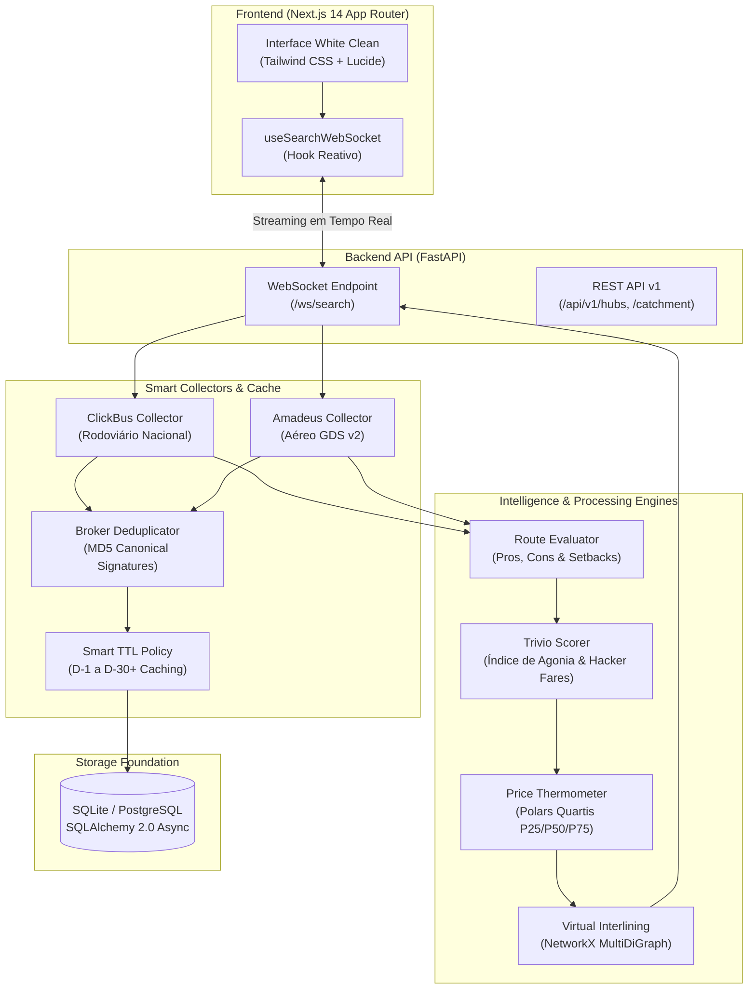

# Trivio — Travel Intelligence & Intermodal Mobility Platform

> **O primeiro comparador de viagens de longa distância do Brasil que coloca Avião e Ônibus na mesma régua.**  
> Cálculo de Custo Efetivo Real de porta a porta, **Trivio Score** (Índice de Agonia com bônus de sono produtivo no leito noturno), **Hacker Fares**, **Virtual Interlining** e streaming em tempo real via WebSockets.

---

## 🎯 Visão Geral do Produto

O mercado brasileiro de mobilidade de passageiros sofre com assimetria de informações e custos ocultos:
- Uma passagem aérea de **R$ 200** frequentemente ultrapassa **R$ 550** ao somar taxas de embarque, franquia de bagagem de 23kg e transporte urbano até aeroportos distantes (ex: Viracopos ou Guarulhos).
- Voos com conexões curtas geram alto risco de perda e estresse desnecessário.
- Por outro lado, um ônibus **Leito Cama Noturno** permite dormir com conforto pleno, economizar uma diária de hotel e chegar ao centro da cidade no início da manhã.

O **Trivio** resolve essa assimetria através de um pipeline algorítmico avançado:
1. **Custo Efetivo Real Porta a Porta:** Desagrega e recalcula taxas ANAC/ANTT, estimativas de bagagem e deslocamentos urbanos.
2. **Trivio Score (Agony Index):** Métrica proprietária que quantifica tempo, custo, cansaço físico e conveniência horária.
3. **Termômetro de Preços (Polars Engine):** Identificação instantânea de tarifas (*LOW*, *MEDIUM*, *HIGH*) baseadas em quartis estatísticos (P25/P50/P75).
4. **Virtual Interlining & Conexões Híbridas:** Algoritmo em grafo NetworkX que viabiliza rotas combinadas (ônibus regional + voo de capital) com garantia de tempo mínimo de conexão (MCT).
5. **Hacker Fares:** Geração automática de opções desdobradas (ex: ida de avião e volta de leito noturno), desbloqueando economias de até 60%.

---

## 🏗️ Arquitetura do Sistema



---

## 🛠️ Stack Tecnológica

### Backend (Python 3.13)
- **Framework Web:** FastAPI (com ciclo de vida assíncrono via `lifespan` e suporte a WebSockets).
- **ORM & Banco de Dados:** SQLAlchemy 2.0 (modo assíncrono), compatível com SQLite e PostgreSQL.
- **Engenharia de Dados:** Polars (cálculo vetorial ultrarrápido de quartis estatísticos de preços).
- **Grafos & Conexões:** NetworkX (algoritmo de interconexão modal com validação de MCT).
- **Geolocalização:** Geopy / Geographiclib (distâncias geodésicas e raios de abrangência regional).
- **Resiliência de Rede:** HTTPX + Tenacity (exponential backoff com jitter e isolamento bulkhead).
- **Qualidade & Testes:** Pytest, Pytest-Asyncio (76 testes unitários automatizados).

### Frontend (Node.js 20+ / Next.js 14)
- **Arquitetura:** Next.js 14 (App Router, Server & Client Components).
- **Linguagem:** TypeScript com tipagem estrita de contratos de API e WebSockets.
- **Estilização:** Tailwind CSS (tema corporativo *White Clean* com esquema oficial de cores da marca).
- **Ícones & UI:** Lucide React.

---

## 📁 Estrutura de Diretórios

```
Viax/
├── app/
│   ├── analyzers/              # Motores de Inteligência do Trivio
│   │   ├── interliner.py       # Virtual Interlining com NetworkX
│   │   ├── price_thermometer.py# Termômetro de preços com Polars
│   │   ├── route_evaluator.py  # Avaliador de prós, contras e contratempos
│   │   └── trivio_scorer.py    # Algoritmo do Trivio Score e Hacker Fares
│   ├── api/                    # Camada de Apresentação e Comunicação
│   │   ├── main.py             # Instância do FastAPI, Lifespan e CORS
│   │   ├── routes.py           # Endpoints REST (Hubs, Terminais, Catchment)
│   │   ├── schemas.py          # Schemas de validação Pydantic v2
│   │   └── websocket.py        # Orquestrador de streaming em tempo real
│   ├── cache/                  # Camada de Cache Inteligente
│   │   ├── deduplicator.py     # Deduplicação cross-broker e assinaturas MD5
│   │   └── ttl_policy.py       # Política dinâmica de TTL conforme antecedência
│   ├── collectors/             # Coletores de Provedores Modais
│   │   ├── base.py             # Classe abstrata, retries e modelo StandardizedQuote
│   │   ├── air/amadeus.py      # Coletor Amadeus v2 (Aéreo)
│   │   └── road/clickbus.py    # Coletor ClickBus (Rodoviário)
│   ├── geo/                    # Inteligência Geográfica
│   │   ├── catchment.py        # Identificação de aeroportos/rodoviárias vizinhas
│   │   └── entity_resolver.py  # Normalização de códigos IATA, ANTT e Nomes
│   ├── config.py               # Configurações centralizadas Pydantic Settings
│   ├── database.py             # Sessões assíncronas do SQLAlchemy 2.0
│   └── models.py               # Modelos relacionais (Hub, Terminal, FareQuote)
├── frontend/                   # Aplicação Web Next.js 14
│   ├── src/
│   │   ├── app/                # App Router (page.tsx, layout.tsx, globals.css)
│   │   ├── components/         # Header, SearchBar, TrustPillars, SkeletonCard
│   │   ├── hooks/              # useSearchWebSocket (streaming reativo)
│   │   └── types/              # Interfaces TypeScript unificadas
│   └── public/                 # Ativos estáticos e logotipos oficiais
├── scripts/                    # Scripts utilitários e de verificação
│   ├── init_db.py              # Inicialização e carga inicial dos Hubs brasileiros
│   ├── test_collector.py       # CLI Runner interativo com saída rica no terminal
│   └── capture_preview.py      # Automação Playwright para testes visuais
├── tests/                      # Suíte completa de testes automatizados (76 testes)
├── .env.example                # Template de configuração de variáveis de ambiente
├── .gitignore                  # Regras de exclusão para Git
├── requirements.txt            # Dependências Python travadas
└── roteiro_trivio.md           # Roteiro canônico e roadmap de desenvolvimento
```

---

## 🚀 Como Executar Localmente

### Pré-requisitos
- **Python 3.11+** (recomendado Python 3.13)
- **Node.js 18+** (recomendado Node.js 20+)
- **Git**

---

### 1. Configuração do Backend (Python)

1. Clone o repositório ou acesse a pasta raiz:
   ```bash
   cd Viax
   ```

2. Crie e ative o ambiente virtual:
   ```bash
   # Windows (PowerShell)
   python -m venv .venv
   .\.venv\Scripts\Activate.ps1

   # Linux / macOS
   python3 -m venv .venv
   source .venv/bin/activate
   ```

3. Instale as dependências:
   ```bash
   pip install -r requirements.txt
   ```

4. Configure as variáveis de ambiente:
   ```bash
   cp .env.example .env
   # Edite o .env se desejar adicionar credenciais da Amadeus ou trocar a DATABASE_URL
   ```

5. Inicialize o banco de dados e faça a carga dos hubs nacionais (SP, Rio, Curitiba, etc.):
   ```bash
   python scripts/init_db.py
   ```

6. Inicie o servidor FastAPI:
   ```bash
   uvicorn app.api.main:app --reload --port 8000
   ```
   - Swagger / Documentação Interativa: `http://localhost:8000/docs`
   - Healthcheck: `http://localhost:8000/health`
   - WebSocket de busca: `ws://localhost:8000/ws/search`

---

### 2. Configuração do Frontend (Next.js)

1. Em um novo terminal, entre na pasta do frontend:
   ```bash
   cd frontend
   ```

2. Instale as dependências:
   ```bash
   npm install
   ```

3. Inicie o servidor de desenvolvimento:
   ```bash
   npm run dev
   ```
   - Acesse a plataforma no navegador: `http://localhost:3000`

---

## 🧪 Execução de Testes Automatizados

O projeto conta com cobertura de testes unitários e de integração cobrindo coletores, motores de inteligência, banco de dados, API REST e canais WebSocket.

### Testes do Backend
```bash
pytest tests/ -v
```
*(Todos os 76 testes unitários devem passar com 100% de sucesso)*

### Verificação e Build do Frontend
```bash
cd frontend
npm run build
```
*(Valida tipagem TypeScript, ESLint e geração estática do App Router sem erros)*

---

## 📜 Licença

Distribuído sob licença comercial proprietária. Todos os direitos reservados à Trivio Travel Intelligence.
