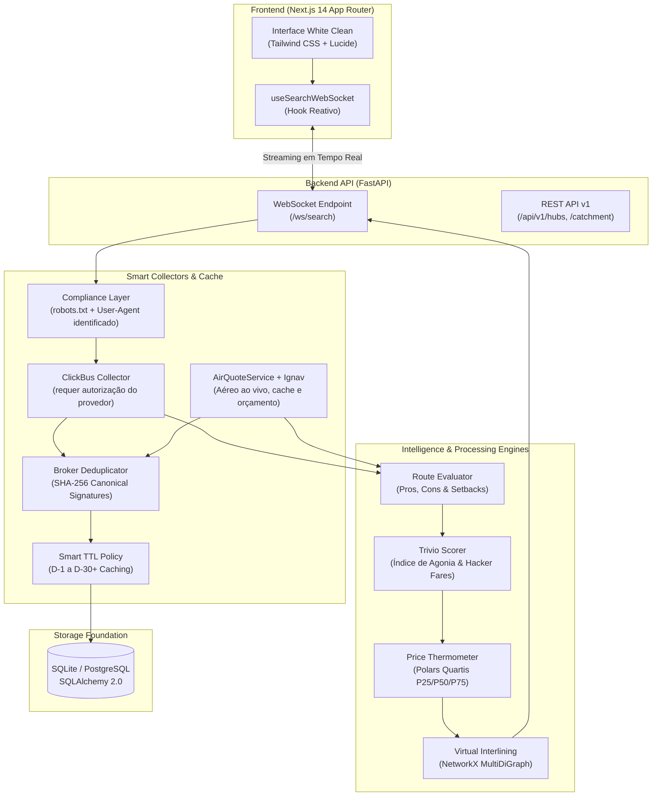

# Trivio — Travel Intelligence & Intermodal Mobility Platform

> **O primeiro comparador de viagens de longa distância do Brasil que coloca Avião e Ônibus na mesma régua.**  
> Cálculo de Custo Efetivo Real de porta a porta, **Trivio Score** (Índice de Agonia com bônus de sono produtivo no leito noturno), **Hacker Fares**, **Virtual Interlining** e streaming em tempo real via WebSockets.

---

## 🎯 Visão Geral do Produto

O mercado brasileiro de mobilidade de passageiros sofre com assimetria de informações e custos ocultos:
- Uma passagem aérea de **R$ 200** frequentemente ultrapassa **R$ 550** ao somar taxas de embarque, franquia de bagagem de 23kg e transporte urbano até aeroportos distantes (ex: Viracopos ou Guarulhos).
- Voos com conexões curtas geram alto risco de perda e estresse desnecessário.
- Por outro lado, um ônibus **Leito Cama Noturno** permite dormir com conforto pleno, economizar uma diária de hotel e chegar ao centro da cidade no início da manhã.

O **Trivio** resolve essa assimetria através de um pipeline algorítmico avançado:
1. **Custo Efetivo Real Porta a Porta:** Desagrega e recalcula taxas ANAC/ANTT, estimativas de bagagem e deslocamentos urbanos.
2. **Trivio Score (Agony Index):** Métrica proprietária que quantifica tempo, custo, cansaço físico e conveniência horária.
3. **Termômetro de Preços (Polars Engine):** Identificação instantânea de tarifas (*LOW*, *MEDIUM*, *HIGH*) baseadas em quartis estatísticos (P25/P50/P75).
4. **Virtual Interlining & Conexões Híbridas:** Algoritmo em grafo NetworkX que viabiliza rotas combinadas (ônibus regional + voo de capital) com garantia de tempo mínimo de conexão (MCT).
5. **Hacker Fares:** Geração automática de opções desdobradas (ex: ida de avião e volta de leito noturno), desbloqueando economias de até 60%.

---

## 🏗️ Arquitetura do Sistema



---

## 🛠️ Stack Tecnológica

### Backend (Python 3.13)
- **Framework Web:** FastAPI (com ciclo de vida assíncrono via `lifespan` e suporte a WebSockets).
- **ORM & Banco de Dados:** SQLAlchemy 2.0 (sessões síncronas), compatível com SQLite e PostgreSQL.
- **Engenharia de Dados:** Polars (cálculo vetorial ultrarrápido de quartis estatísticos de preços).
- **Grafos & Conexões:** NetworkX (algoritmo de interconexão modal com validação de MCT).
- **Geolocalização:** Geopy / Geographiclib (distâncias geodésicas e raios de abrangência regional).
- **Resiliência de Rede:** HTTPX + Tenacity (exponential backoff com jitter e isolamento bulkhead).
- **Conformidade de Coleta:** Protego (robots.txt pela spec do Google), agente identificado e respeito a `Crawl-delay` / `Retry-After`.
- **Qualidade & Testes:** Pytest, Pytest-Asyncio (223 testes automatizados).

### Frontend (Node.js 20+ / Next.js 14)
- **Arquitetura:** Next.js 14 (App Router, Server & Client Components).
- **Linguagem:** TypeScript com tipagem estrita de contratos de API e WebSockets.
- **Estilização:** Tailwind CSS (tema corporativo *White Clean* com esquema oficial de cores da marca).
- **Ícones & UI:** Lucide React.

---

## 🤝 Política de Coleta de Dados

O Trivio só obtém preços de fontes que autorizam o acesso. Toda requisição a sites de
terceiros passa por [`app/collectors/compliance.py`](app/collectors/compliance.py), que garante:

| Princípio | Como é aplicado |
|---|---|
| **Identificação honesta** | `User-Agent: TrivioBot/1.0 (+url; contato)`. Nunca imitamos um navegador. |
| **Autorização** | O `robots.txt` de cada host é verificado antes da requisição, com `protego`. |
| **Ritmo educado** | Respeita `Crawl-delay`, intervalo mínimo por host e `Retry-After` (HTTP 429). |
| **Obediência a recusas** | HTTP 401/403 encerra a coleta. Sem retentativa, sem navegador headless, sem contorno. |

> ⚠️ **Não use `urllib.robotparser`.** A implementação da stdlib aplica a *primeira* regra que
> casa, então um `Allow: /` no topo do arquivo anula todos os `Disallow` seguintes — ela chega a
> liberar `/login` e `/checkout/`. A spec do Google usa a regra *mais específica*, que é o que o
> `protego` implementa.

Se um provedor recusa acesso automatizado, o desbloqueio é **comercial** (API oficial ou programa
de parceiros), nunca técnico.

### Estado atual dos provedores

| Provedor | Modal | Situação |
|---|---|---|
| **Ignav** | Aéreo (preço ao vivo) | ✅ API contratada, com chave (`IGNAV_API_KEY`) e cobrança por request. Não é raspagem. Ver *Preços aéreos ao vivo*. |
| **ANAC** (microdados de tarifas) | Aéreo (régua do Termômetro) | ✅ Dados abertos oficiais, sem chave. Ver *Régua aérea*. |
| **ANTT (dados abertos)** | Rodoviário | ✅ Público e sem chave. Tarifas **históricas reais** sob CC-BY (a API CKAN é proibida pelo `robots.txt`; usamos os caminhos permitidos). |
| **ClickBus** | Rodoviário | ⛔ Sem autorização. O `robots.txt` proíbe as páginas de resultado (`Disallow: /*?departureDate=`) e o WAF responde 403 ao endpoint interno. Depende da API B2B de parceiros. |

> **Regra para APIs contratadas.** Provedores como o Ignav são acessados com chave e contrato. O
> cliente identificado de APIs não consulta `robots.txt`, porque o acesso já é autorizado pelo
> contrato. Isso não vale para sites: raspagem continua passando pelo `CompliantHTTPClient`.

### Preços aéreos ao vivo (Ignav)

A busca aérea consulta a [Ignav Flight Prices API](https://ignav.com/docs) em BRL (`IGNAV_MARKET=BR`)
e devolve voos só de ida, de LATAM, GOL e Azul, com `observed_at` e o status do preço
(`verified` ou `unverified`).

Toda request ao Ignav é paga. Por isso, qualquer consulta passa pelo `AirQuoteService`
([`app/services/air_quotes.py`](app/services/air_quotes.py)), nesta ordem:

1. **Cache de consultas** (tabela `provider_queries`): consultas iguais válidas por até 2 h, ou
   30 min para voos próximos, respondem sem nova request. Consultas vazias também são guardadas.
2. **Orçamento mensal** (`AIR_MONTHLY_REQUEST_BUDGET`, padrão 800): ao atingir o teto, o aéreo para
   de consultar e a interface recebe um `PROVIDER_ERROR` com `reason: "budget_exhausted"`.
3. **Coalescência:** buscas idênticas simultâneas dividem uma única request.
4. **Coletor** (`app/collectors/air/ignav.py`): uma chamada = uma request paga.

Motivos de falha informados ao frontend, em vez de uma lista vazia com aparência de sucesso:

| `reason` | Quando |
|---|---|
| `not_configured` | `IGNAV_API_KEY` ausente |
| `disabled` | `AIR_MONTHLY_REQUEST_BUDGET=0` |
| `budget_exhausted` | Teto mensal atingido |
| `provider_error` | Erro do provedor (timeout, 402, 429, 503, etc.) |

**Custo.** O Ignav oferece 1.000 requests grátis, uma única vez. Depois disso, cada 1.000
requests bem-sucedidas custam US$ 2, cobrados por mês. Um cartão de crédito precisa estar
cadastrado na conta para que as requests continuem. Sem ele, a API responde HTTP 402.

**Preço e taxas.** O Ignav devolve o total do bilhete, com taxas. A régua da ANAC mede só a tarifa,
então o Trivio separa uma taxa de embarque estimada (`DEFAULT_DOMESTIC_BOARDING_FEE_BRL`, padrão
R$ 40) para comparar. Os valores por aeroporto ficam em
[`boarding_fees.py`](app/collectors/air/boarding_fees.py) e ainda não estão preenchidos.

**Link de compra.** A busca não traz o link. Ele é resolvido só no clique, por
`GET /api/v1/air/booking-link`, que custa uma request e fica em cache por 30 min. A companhia
aérea é preferida quando oferece o voo exato.

**Histórico.** Cotações ao vivo não são gravadas no histórico permanente (`FareQuote`) por padrão,
porque os termos de uso do provedor ainda não foram conferidos. Isso é controlado por
`AIR_PERSIST_LIVE_QUOTES`.

**Consumo.** `GET /api/v1/air/usage` mostra as requests usadas e as restantes no mês, contadas pelo
próprio Trivio. Esse número não reflete o saldo de crédito do Ignav, que só aparece no painel do
provedor.

**Virtual Interlining.** O voo do hub só é consultado depois que o trecho de ônibus até o hub
trouxe resultado. Assim, não se paga por uma rota híbrida que não se forma.

### Régua aérea (ANAC)

O Termômetro de Preço classifica voos com as **tarifas domésticas efetivamente vendidas**,
publicadas pela ANAC desde 2002 (Resolução ANAC nº 437/2017). Os microdados vêm de
`sas.anac.gov.br/sas/tarifadomestica/`, com cerca de um mês de defasagem.

```bash
# Ver os meses publicados
python scripts/import_anac_fares.py --list

# Importar os 12 meses mais recentes (janela usada pelo Termômetro)
python scripts/import_anac_fares.py --months 12
```

Cada rota é aeroporto a aeroporto (ex.: `SBSP→SBRJ`), com a média ponderada e os percentis
P10 a P90 ponderados por assento, guardados por mês de venda. A régua combina os 12 meses mais
recentes e exige pelo menos **3 meses** e **300 assentos** na janela.

Os microdados não separam compras com muita e com pouca antecedência, e o mês é o da venda,
não o do voo. Por isso, a régua mostra se a tarifa é cara ou barata para a rota, mas não prevê
o preço de uma data específica.

> A régua compara só a **tarifa base**, porque o valor da ANAC não inclui taxa de embarque nem
> bagagem. O Termômetro ignora taxas e franquias ao classificar uma cotação aérea.

### Tarifas históricas reais (ANTT / Monitriip)

O [Portal de Dados Abertos da ANTT](https://dados.antt.gov.br) publica, sob licença Creative
Commons Attribution, os **bilhetes efetivamente comercializados** no transporte rodoviário
interestadual e internacional (conjunto `monitriip-bilhetes-de-passagem`, um CSV por mês desde
2019, atualizado mensalmente).

O portal roda CKAN e teria uma Action API em `/api/`, mas o `robots.txt` dele a proíbe
(`Disallow: /api/`). Então a descoberta dos arquivos é feita pela **página pública do conjunto**
e o download pelas **URLs de recurso**, ambas permitidas. O `Crawl-Delay: 10` do portal é
respeitado, o que deixa a importação propositalmente lenta.

O Trivio usa essa série para alimentar o **Termômetro de Preço** com percentis reais por
corredor, em vez de depender de um histórico próprio que leva meses para acumular:

```bash
# Ver os arquivos mensais publicados
python scripts/import_antt_fares.py --list

# Conferir o cabeçalho real antes de importar (o esquema da ANTT já mudou entre safras)
python scripts/import_antt_fares.py --inspect venda_passagem_09_2024.csv

# Baixar e importar os 3 meses mais recentes
python scripts/import_antt_fares.py --months 3
```

Os bilhetes individuais **não** são persistidos. O importador grava uma série mensal por rota,
classe e mês de viagem (tabela `route_monthly_fares`), com o preço médio ponderado pela quantidade
de bilhetes. Só a **tarifa normal** entra: gratuidades e descontos de grupo ficam de fora.

O Termômetro calcula os percentis sobre os **meses de viagem** da rota, e só classifica quando há
pelo menos **6 meses** (`MIN_OFFICIAL_MONTHS`). Abaixo disso, recorre ao histórico coletado pelo
próprio Trivio ou mostra `INSUFFICIENT_DATA`. Um arquivo mensal sozinho quase não cobre rota
nenhuma: a cobertura cresce com cada mês importado.

> A comparação usa o **preço do bilhete** (tarifa + taxas), não o custo efetivo porta a porta:
> a ANTT mede a passagem, então somar transfer urbano classificaria toda cotação como cara.

**Limite:** a ANTT cobre o histórico, não a disponibilidade. Preço comprável em tempo real
continua dependendo de acordo com um distribuidor.

Quando nenhum provedor real responde, o Trivio exibe **estimativas calculadas pela distância
geodésica**, sempre marcadas na interface como *"Estimativa simulada"*, sem link de compra e
**nunca gravadas no banco** — para não contaminar o histórico do Termômetro de Preço.

---

## 📁 Estrutura de Diretórios

```
trivio/
├── app/
│   ├── analyzers/              # Motores de Inteligência do Trivio
│   │   ├── interliner.py       # Virtual Interlining com NetworkX
│   │   ├── price_thermometer.py# Termômetro de preços com Polars
│   │   ├── route_evaluator.py  # Avaliador de prós, contras e contratempos
│   │   └── trivio_scorer.py    # Algoritmo do Trivio Score e Hacker Fares
│   ├── api/                    # Camada de Apresentação e Comunicação
│   │   ├── main.py             # Instância do FastAPI, Lifespan e CORS
│   │   ├── routes.py           # Endpoints REST (Hubs, Terminais, Catchment)
│   │   ├── schemas.py          # Schemas de validação Pydantic v2
│   │   └── websocket.py        # Orquestrador de streaming em tempo real
│   ├── cache/                  # Camada de Cache Inteligente
│   │   ├── deduplicator.py     # Deduplicação cross-broker e assinaturas SHA-256
│   │   └── ttl_policy.py       # Política dinâmica de TTL conforme antecedência
│   ├── collectors/             # Coletores de Provedores Modais
│   │   ├── base.py             # Classe abstrata, retries e modelo StandardizedQuote
│   │   ├── compliance.py       # robots.txt, User-Agent identificado, ritmo e recusas
│   │   ├── air/
│   │   │   ├── ignav.py        # Coletor aéreo ao vivo (Ignav): cliente HTTP e parser
│   │   │   ├── carriers.py     # Nomes canônicos das companhias (LATAM, GOL, Azul...)
│   │   │   └── boarding_fees.py# Taxa de embarque estimada por aeroporto de origem
│   │   ├── anac/               # Microdados de tarifas aéreas da ANAC (régua)
│   │   │   ├── portal.py       # Descoberta e download na listagem da ANAC
│   │   │   ├── airfares.py     # Leitura e agregação por rota e mês (percentis ponderados)
│   │   │   └── airports.py     # De-para IATA <-> ICAO dos aeroportos
│   │   ├── antt/               # Dados abertos da ANTT (Monitriip)
│   │   │   ├── portal.py       # Descoberta e download pelos caminhos permitidos
│   │   │   └── monitriip.py    # Detecção de esquema e agregação de tarifas
│   │   └── road/
│   │       ├── clickbus.py     # Coletor ClickBus (requer autorização do provedor)
│   │       └── taxonomy.py     # Normalização de classes (Leito, Semi-Leito, …)
│   ├── geo/                    # Inteligência Geográfica
│   │   ├── catchment.py        # Identificação de aeroportos/rodoviárias vizinhas
│   │   └── entity_resolver.py  # Normalização de códigos IATA, ANTT e Nomes
│   ├── services/               # Orquestração do Pipeline de Dados
│   │   ├── air_quotes.py       # Aéreo ao vivo: cache de consultas, orçamento e coalescência
│   │   └── quote_pipeline.py   # Resolução canônica, transfer urbano, dedup e persistência
│   ├── config.py               # Configurações centralizadas Pydantic Settings
│   ├── database.py             # Sessões do SQLAlchemy 2.0 e migração leve de colunas
│   └── models.py               # Modelos relacionais (Hub, Terminal, FareQuote, RouteMonthlyFare, ProviderQuery)
├── frontend/                   # Aplicação Web Next.js 14
│   ├── src/
│   │   ├── app/                # App Router (page.tsx, layout.tsx, globals.css)
│   │   ├── components/         # Header, SearchBar, TrustPillars, SkeletonCard
│   │   ├── hooks/              # useSearchWebSocket (streaming reativo)
│   │   └── types/              # Interfaces TypeScript unificadas
│   └── public/                 # Ativos estáticos e logotipos oficiais
├── scripts/                    # Scripts utilitários e de verificação
│   ├── init_db.py              # Inicialização e carga inicial dos Hubs brasileiros
│   ├── import_antt_fares.py    # Importa tarifas históricas reais da ANTT (Monitriip)
│   ├── import_anac_fares.py    # Importa tarifas aéreas domésticas vendidas (régua da ANAC)
│   ├── test_collector.py       # CLI Runner interativo com saída rica no terminal
│   └── capture_preview.py      # Automação Playwright do frontend próprio (preview visual)
├── tests/                      # Suíte completa de testes automatizados (223 testes)
│   ├── fixtures/               # Resposta real do Ignav, com identificadores fictícios
├── .env.example                # Template de configuração de variáveis de ambiente
├── .gitignore                  # Regras de exclusão para Git
├── requirements.txt            # Dependências Python travadas
└── roteiro_trivio.md           # Roteiro canônico e roadmap de desenvolvimento
```

---

## 🚀 Como Executar Localmente

### Pré-requisitos
- **Python 3.11+** (recomendado Python 3.13)
- **Node.js 18+** (recomendado Node.js 20+)
- **Git**

---

### 1. Configuração do Backend (Python)

1. Clone o repositório ou acesse a pasta raiz:
   ```bash
   cd trivio
   ```

2. Crie e ative o ambiente virtual:
   ```bash
   # Windows (PowerShell)
   python -m venv .venv
   .\.venv\Scripts\Activate.ps1

   # Linux / macOS
   python3 -m venv .venv
   source .venv/bin/activate
   ```

3. Instale as dependências:
   ```bash
   pip install -r requirements.txt
   ```

4. Configure as variáveis de ambiente:
   ```bash
   cp .env.example .env
   ```
   No `.env`, vale preencher:
   - `IGNAV_API_KEY` — chave da [Ignav Flight Prices API](https://ignav.com). **Sem ela o aéreo ao vivo
     fica desligado** (`reason: "not_configured"`). Ver *Preços aéreos ao vivo*.
   - `AIR_MONTHLY_REQUEST_BUDGET` — teto de requests pagas por mês (padrão 800; `0` desliga o aéreo ao vivo).
   - `AIR_LIVE_CACHE_MAX_SECONDS` — validade máxima do cache de consultas aéreas (padrão 7200).
   - `AIR_PERSIST_LIVE_QUOTES` — `false` por padrão: cotações ao vivo não entram no histórico permanente.
   - `DEFAULT_DOMESTIC_BOARDING_FEE_BRL` — taxa de embarque estimada para separar tarifa e taxa (padrão 40).
   - `PUBLIC_API_BASE_URL` — endereço público da API, usado nos links de compra (padrão `http://localhost:8000`).
   - `BOT_INFO_URL` / `BOT_CONTACT_EMAIL` — identificam o robô do Trivio no `User-Agent`
     e dão aos sites um canal de contato. Veja *Política de Coleta de Dados* acima.
   - `DATABASE_URL` — troque para PostgreSQL em produção.

   O `.env.example` traz todas as variáveis com os valores padrão.

5. Inicialize o banco de dados e faça a carga dos hubs nacionais (SP, Rio, Curitiba, etc.):
   ```bash
   python scripts/init_db.py
   ```
   Os testes de WebSocket precisam desses hubs cadastrados. Para ter a régua aérea completa,
   rode também `python scripts/import_anac_fares.py --months 12`.

6. Inicie o servidor FastAPI:
   ```bash
   uvicorn app.api.main:app --reload --port 8000
   ```
   - Swagger / Documentação Interativa: `http://localhost:8000/docs`
   - Healthcheck: `http://localhost:8000/health`
   - WebSocket de busca: `ws://localhost:8000/ws/search`

---

### 2. Configuração do Frontend (Next.js)

1. Em um novo terminal, entre na pasta do frontend:
   ```bash
   cd frontend
   ```

2. Instale as dependências:
   ```bash
   npm install
   ```

3. Inicie o servidor de desenvolvimento:
   ```bash
   npm run dev
   ```
   - Acesse a plataforma no navegador: `http://localhost:3000`

---

## 🧪 Execução de Testes Automatizados

O projeto conta com cobertura de testes unitários e de integração cobrindo coletores, motores de inteligência, banco de dados, API REST e canais WebSocket.

### Testes do Backend
```bash
pytest tests/ -v
```
*(Todos os 223 testes devem passar com 100% de sucesso, após `python scripts/init_db.py`)*

### Verificação e Build do Frontend
```bash
cd frontend
npm run build
```
*(Valida tipagem TypeScript, ESLint e geração estática do App Router sem erros)*

---

## 📜 Licença

Distribuído sob licença comercial proprietária. Todos os direitos reservados à Trivio Travel Intelligence.
